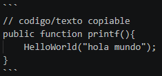

# <center> <ins> ***Tutorial Markdown*** </ins> </center>

# **Indice de contenido**
- [**General**](#general)
- [**Estilos de texto**](#estilos-de-texto)
- [**Lineas de comentario (Citas)**](#linea-de-comentario-cita)
- [**Imagenes y Enlaces**](#imagenes--links)
- [**Util**](#util)
- [**Cajas de codigo copiable**](#cajas-de-codigo-copiable)
***

# <center>**General:**</center>
## **Texto normal:**
lorem ipsum bla bla bla ble ble ble blu blu blu
## **Salto de linea:**
lorem ipsum\
dolor input
```md
lorem ipsum\
dolor input
```
> [!TIP]
> usando <kbd>ALT GR</kbd> + <kbd>'</kbd> <sub>(tecla a la derecha del 0)</sub>\
> o tambien con `<br>`

## **Separador de texto**
### separador 1
***
```md
***
```
### separador 2
---
```md
---
```
### separador 3
___
```md
___
```
> [!NOTE]
> No hay diferencia de cada uno realmente, es mas personal a nivel de visualizacion dentro del codigo

## **Emojis:**
presiona (<kbd>Windows</kbd> + <kbd>.</kbd>)
### 😁 🤣 😭 🤑 ❤ 🈵 🎅 ✌
***
# **Titulos:**
# titulo 1
```md
# titulo 1
```
## titulo 2
```md
## Titulo 2
```
### titulo 3
```md
### titulo 3
```
#### titulo 4
```md
#### titulo 4
```
##### titulo 5
```md
##### titulo 5
```
###### titulo 6
```md
###### titulo 6
```
***
# <center> **Estilos de texto:**
### texto en *cursiva*
```md
texto en *cursiva*
```
### texto en **negrita**
```md
texto en **negrita**
```
### texto en ***cursiva y negrita***
```md
texto en ***cursiva y negrita***
```
### texto ~~tachado~~
```
texto ~~tachado~~
```
### texto `resaltado`
```
texto `resaltado`
```
## **Los siguientes se implementa etiquetas HTML**

### texto <sub>subindice</sub>
```html
texto <sub>subindice</sub>
```
### texto <sup>superindice</sup>
```html
texto <sup>superindice</sup>
```
### texto <mark>remarcado</mark>
```html
texto <mark>remarcado</mark>
```
### texto <ins>subrayado</ins>
```html
texto <ins>subrayado</ins>
```
### <center>texto centrado</center>
```html
<center>texto centrado</center>
```
### texto desplegable
<details>
<summary>ejemplo:</summary>
Este contenido esta oculto hasta que haces clic en el título
</details>

```html
<details>
<summary>ejemplo:</summary>
Este contenido esta oculto hasta que haces clic en el título
</details>
```

### resaltado de teclas
ejemplo:\
Presiona <kbd>Ctrl</kbd> + <kbd>S</kbd> para guardar los cambios.
```html
Presiona <kbd>Ctrl</kbd> + <kbd>S</kbd> para guardar los cambios.
```

### Formulas matematicas
$$ x = \frac{-b \pm \sqrt{b^2 - 4ac}}{2a} $$
```html
$$ x = \frac{-b \pm \sqrt{b^2 - 4ac}}{2a} $$
```
***
# <center> **Linea de comentario (cita):**
> linea 1
```md
> linea 1
```
> linea 1
>> linea 2
>>> linea 3
>>>> linea 4...

```
> linea 1
>> linea 2
>>> linea 3
>>>> linea 4...
```

> # Se pueden incluir titulos 
> ## en las lineas
>> ### *tambien* se **puede** `incluir` <mark>estilos</mark> <sub>de texto</sub>

## Extensiones especiales
> [!NOTE]
> ### notas agregadas
```md
> [!NOTE]
> notas agregadas
```

> [!TIP]
> ### consejos y ayudas
```md
> [!TIP]
> consejos y ayudas
```
> [!IMPORTANT]
> ### importante para tomar en cuenta
```md
> [!IMPORTANT]
> importante para tomar en cuenta
```
> [!WARNING]
> ### Atencion, precaucion
```md
> [!WARNING]
> Atencion, precaucion
```
> [!CAUTION]
> ### Peligro, alerta
```md
> [!CAUTION]
> ### Peligro, alerta
```
***
# <center> **Imagenes + Links**

## **Imagen:**
**Sintaxis:**\
`!` + `[ alt text]` + `(link/direccion)`
### El <kbd>!</kbd> es el que *define* que sera una *Imagen*
ejemplos:

## Imagen de archivo (descargada/capturada en el equipo)


```md

```

## Imagen de internet/web 


```md

```
> [!IMPORTANT]
> El link de la imagen debe ser tomada de la fuente original, en este caso es directamente de Wikipedia, no copiando la imagen desde Google Imagenes

> [!NOTE]
> ### Los **videos No estan disponibles para renderizar por seguridad**, por lo que se tiene que usar un *Enlace Externo* (se puede incluir miniatura) o un *Gif*:
> Tampoco se puede renderizar un video/archivo local
### `archivo.gif`

```md

```
### Video + miniatura
**sintaxis:**
1. `[ ]`
   1. `!` + `[alt text]` + `(link de imagen"miniatura")`
2. `(link del video)`

[](https://youtu.be/x_3As4USenY?si=4aJoE6es4qumqvqF)

>[!TIP]
> Es preferible usar direcciones relativas en vez de absolutas:\
> `./` = **en la misma carpeta actual**\
> `carpeta/` = **entrar a una subcarpeta**\
> `../` = **una carpeta atrás**\
> `../../` = **dos carpetas atrás**\
> `../otra-carpeta/` = **subir un nivel y entrar a otra carpeta**

## **Links:**
## Enlaces externos:

Se usan para redirigir fuera del archivo, puede ser web o de archivo

**Sintaxis:**\
`[ Texto visible para acceder al enlace ]` + `(link)`

ejemplos:

### [**Google**](https://www.google.com)
```md
[Google](https://www.google.com)
```

## Enlaces internos:

Se usan para redirigir a un lugar de la pagina misma

**Sintaxis:**\
`[ Texto visible para acceder al enlace ]` + `( # + titulo)`\
La **sintaxis del titulo** es:\
`#` + `titulo` (separado por guiones `-` y todo en minuscula)

### [*Ir al inicio*](#tutorial-markdown)
```md
[Ir al inicio](#tutorial-markdown)
```
***
# <center> **Util:**
# **Listas:**
## Lista enumerada
1. **lista 1**
2. **lista 2**
3. **lista 3**
   1. **presiona <kbd>Tab</kbd> para agregar lista interna**
   2. **lista 3.2**
      1. **lista 3.2.1**
4. **presiona <kbd>Enter</kbd> para continuar con la lista**

```md
1. lista 1
2. lista 2
3. lista 3
   1. presiona Tab para agregar lista interna
   2. lista 3.2
4. presiona Enter para continuar con la lista
```

## Lista desordenada
- **lista 1**
- **lista 2**
- **lista 3**
* **lista 4 (pueden usar diferentes simbolos)**
  * **<kbd>+</kbd>, <kbd>-</kbd>, <kbd>*</kbd>**
* **lista 5**
```md
- lista 1
- lista 2
- lista 3
* lista 4 (pueden usar diferentes simbolos)
  * + , - , *
* lista 5
```

# **Checkbox:**

- [ ] checkbox vacio
- [x] checkbox lleno
```md
- [ ] checkbox vacio
- [x] checkbox lleno
```

# **Tablas:**

### **Sintaxis basica:**
**Titulo:** `| t | t |`\
**separador:** `| - | - |`\
**descripcion:** `| d | d |`

ejemplo:

|      **Columna 1** |   **Columna 2**    | **Columna 3**        |
| -----------------: | :----------------: | :------------------- |
| texto a la derecha | texto en el centro | texto a la izquierda |

```md
|      **Columna 1** |   **Columna 2**    | **Columna 3**        |
| -----------------: | :----------------: | :------------------- |
| texto a la derecha | texto en el centro | texto a la izquierda |
```

# **Caracter de escape**
con este caracter `\` antes de un caracter especial, se *anula* su funcionalidad

### texto en \*\*negrita\*\*
```md
texto en \*\*negrita\*\*
```
### \# Titulo principal
```md
\# Titulo principal
```
***
# <center> **Cajas de codigo copiable:**
```
// codigo/texto copiable
public function printf(){
    HelloWorld("hola mundo");
}
```
> [!IMPORTANT]
> ### Se usa insertando *3* comillas invertidas `(```)` al inicio del codigo y al final
> usando <kbd>ALT GR</kbd> + <kbd>}</kbd> <sub>(tecla a la izquierda del Enter)</sub>



> [!TIP]
> ### se puede usar el lenguaje de codigo a la derecha de las primeras comillas para estilizarlo acorde al lenguaje
### HTML:
```html
<div class="card">
  <h2>Gestión de Torneos</h2>
  <button class="btn-primary">Registrar Equipo</button>
</div>
```
### java:
```Java
@RestController
@RequestMapping("/api/torneos")
public class TorneoController {

    @GetMapping
    public ResponseEntity<List<Torneo>> listarTorneos() {
        return ResponseEntity.ok(torneoService.obtenerTodos());
    }
}
```
### C#:
```cs
[HttpGet("{id}")]
public async Task<IActionResult> GetEventoById(int id)
{
    var evento = await _context.Eventos.FindAsync(id);
    if (evento == null) return NotFound();
    return Ok(evento);
}
```
### Terminal:
```bash
git init
git add .
git commit -m "feat: módulo de inscripciones completado"
git push origin main
```

## Extra
### Se usa `diff` para mostrar cambios como en *Github*
```diff
- string connectionString = "Server=localhost;Database=TestDb;";
+ string connectionString = "Server=DESKTOP-BV9MNRK\\SQLEXPRESS;Database=dbEventos;Trusted_Connection=True;";
```
---
<center>Fin, por ahora</center>

---
### **Pagina de ayuda:**
### Aqui una guia mas completa sobre el uso de MarkDown: [GitHub Docs](https://docs.github.com/es/get-started/writing-on-github/getting-started-with-writing-and-formatting-on-github/basic-writing-and-formatting-syntax)